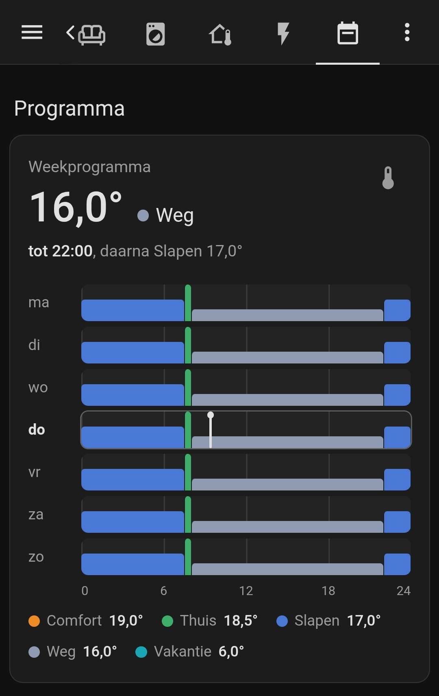

# Toon Program

Custom Home Assistant integration for a **rooted Eneco Toon** thermostat. It reads
**and writes** the week program (`thermostatProgram`) and the five temperature
presets (`thermostatStates`) through the local `hcb_config` HTTP interface — no
cloud, no account, no credentials.

The existing Toon integrations (`toon_climate`, `toon_smartmeter`,
`toon_boilerstatus`) only use the presets indirectly, to map a setpoint to a
preset. The schedule itself stays out of sight. This integration covers that
part.

## Features

- **Week program as a sensor** — the complete schedule (21 blocks in a typical
  program) is exposed as attributes, with start, end and duration per block.
- **Calendar** — the same schedule as a recurring weekly calendar, including the
  preset and its temperature in the event title.
- **Five preset temperatures as `number` entities** — 5–30 °C in 0.5 °C steps,
  written straight to the Toon.
- **Schedule sensors** — active preset, the temperature that belongs to it, the
  next preset and the exact moment of the next change, refreshed at every block
  boundary.
- **Services** — replace the whole week program or just one day.
- **Automatic backups** — the object that is about to change is saved first,
  with a manual backup button and a restore service.
- **Lovelace card** — a themed week view with a day editor and a preset
  temperature panel, registered automatically (no manual resource needed).
- **Config flow** — add, reconfigure (new IP address) and set the polling
  interval from the UI. English and Dutch translations.
- **Diagnostics** — presets, program, backups and last update status, with the
  host redacted.

## Requirements

- A **rooted Toon** with the local web interface reachable on port 80
  (`/hcb_config`). Tested with `lighttpd/1.4.35`.
- Home Assistant **2024.7** or newer.
- The Toon and Home Assistant on the same network.

The integration validates a Toon before it is added: `getLocale`,
`thermostatStates` and `thermostatProgram` must all answer, otherwise the config
flow refuses to create a half-working entry.

## Installation

### HACS

1. HACS → Integrations → ⋮ → **Custom repositories**.
2. Add `https://github.com/MarkvdDr/HomeAssistantIntegrations` with category
   **Integration**.
3. Install **Toon Program** and restart Home Assistant.
4. Settings → Devices & services → **Add integration** → **Toon Program**.

### Manual

Copy `custom_components/toon_program` to `/config/custom_components/` and restart
Home Assistant.

> A new custom integration is only loaded after a **full restart** of Home
> Assistant. Reloading YAML is not enough.

## Configuration

| Field | Meaning | Default |
| --- | --- | --- |
| Host | IP address or host name of the Toon | — |
| Port | Port of the local web interface | `80` |
| Name | Device name in Home Assistant | `Toon Program` |
| Refresh interval | Poll interval in seconds | `300` |

The interval can be changed later via **Configure**. The program changes rarely,
so 300 seconds is plenty; 30 seconds is the minimum. The entities that describe
the *current* block update themselves at every block boundary, independent of
the poll interval.

Use **Reconfigure** after the Toon received a new IP address: entities,
dashboards and automations keep working.

## Entities

Names below are the English defaults. Entity IDs follow your Home Assistant
language, so a Dutch installation creates e.g.
`number.toon_program_temperatuur_comfort`.

### Sensors

| Entity | Meaning |
| --- | --- |
| `sensor.toon_program_week_program` | Number of blocks, with the full schedule as attributes |
| `sensor.toon_program_active_preset` | Preset the program applies right now |
| `sensor.toon_program_program_temperature` | Temperature of that preset |
| `sensor.toon_program_next_preset` | Preset of the next block, with its `temperature` attribute |
| `sensor.toon_program_next_change` | Timestamp at which the next block starts |

The week program sensor carries these attributes:

- `blocks` — every block with `day`, `time`, `preset`, `end_day`, `end_time` and
  `duration_minutes`;
- `days` — the same blocks grouped per day;
- `preset_temperatures` — the five presets with their temperature;
- `preset_entities` — the matching `number` entity per preset;
- `backups` — the available backup files;
- `locale` and `timezone` — as reported by the Toon.

### Numbers

One per preset: `comfort`, `home`, `sleep`, `away`, `holiday`. Range 5–30 °C,
step 0.5 °C. A preset that is missing on the Toon becomes `unavailable` instead
of a made-up value.

### Calendar

`calendar.toon_program_week_program` shows the schedule as weekly recurring
events. Each event runs from its start to the start of the next block, so the
last block of the week continues into the first block.

### Button

`button.toon_program_create_backup` (configuration category) writes the current
week program and presets to the backup folder.

## Lovelace card



The integration serves its own card and registers it as a frontend module, so no
Lovelace resource has to be added. The URL contains the integration version,
which refreshes the browser cache after an update.

```yaml
type: custom:toon-program-card
entity: sensor.toon_program_week_program
title: Week program      # optional
week_start: monday       # monday (default) or sunday
editable: true           # optional, default true
show_legend: true        # optional, default true
```

What the card shows:

- the current preset and temperature, plus the next change;
- a week overview with one bar per day, a "now" marker and a legend;
- click a day to open the editor: change start time and preset per block, add or
  remove blocks, and copy the edited day to other days in one save;
- the thermometer button opens the preset temperature panel with 0.5 °C steps.

The card is responsive. A block row stays on one line as long as the widest
preset name fits, and only stacks (time and delete above, preset and temperature
below) when the card is genuinely too narrow. All labels remain readable at any
width.

If the card does not appear, check that the integration is loaded and reload the
browser page once after installing or updating.

## Services

All services target a sensor of the integration (the week program sensor is the
natural choice).

### `toon_program.set_schedule`

Replaces the complete week program. Each block has a day, a start time and a
preset. End times are derived from the next block; the last block of the week
runs until the first block.

```yaml
service: toon_program.set_schedule
target:
  entity_id: sensor.toon_program_week_program
data:
  blocks:
    - {day: monday, time: "07:30", preset: home}
    - {day: monday, time: "08:00", preset: away}
    - {day: monday, time: "22:00", preset: sleep}
    - {day: tuesday, time: "07:30", preset: home}
    - {day: tuesday, time: "08:00", preset: away}
    - {day: tuesday, time: "22:00", preset: sleep}
```

- `day`: `sunday`…`saturday`; Dutch `zondag`…`zaterdag` and short forms
  (`zo`, `ma`, `di`, `wo`, `do`, `vr`, `za`, `mon`, `tue`, …) also work.
- `time`: `HH:MM`.
- `preset`: `comfort`, `home`, `sleep`, `away` or `holiday`.

### `toon_program.set_day`

Replaces only the blocks that **start** on one day; the other days stay as they
are.

```yaml
service: toon_program.set_day
target:
  entity_id: sensor.toon_program_week_program
data:
  day: saturday
  blocks:
    - {time: "09:00", preset: comfort}
    - {time: "23:00", preset: sleep}
```

An empty list (`blocks: []`) removes every block of that day; the previous day
then spans it.

### `toon_program.create_backup`

Writes the week program and the presets to the backup folder immediately.

```yaml
service: toon_program.create_backup
target:
  entity_id: sensor.toon_program_week_program
```

### `toon_program.restore_backup`

Writes a backup back to the Toon. Without `filename` the newest backup of that
kind is used.

```yaml
service: toon_program.restore_backup
target:
  entity_id: sensor.toon_program_week_program
data:
  kind: program          # program (default) or presets
  filename: program-20261122-195139-set_schedule.json
```

A backup made on a different Toon (different `uuid`) is refused.

## Backups

- Location: `/config/toon_program_backups/<entry-id-prefix>/`.
- Before **every** write the object that is about to be replaced is saved, so a
  change can always be undone.
- An identical newest backup is not written twice.
- The 20 newest backups per kind (`program`, `presets`) are kept.
- The files are plain JSON with the object exactly as the Toon returned it, and
  they are included in a normal Home Assistant backup.

The files are also listed in the week program sensor's `backups` attribute and
in the integration diagnostics.

## How it works

The integration uses four actions on `http://<toon>/hcb_config`:

| Action | Use |
| --- | --- |
| `getLocale` | locale and time zone |
| `getObjectConfigTree` | look up the object `uuid` |
| `getObjectConfig` | read a complete object (node list) |
| `setObjectConfig` | write an object back |

Every write is a **read-modify-write**:

1. The complete object is read again, including `uuid`, `type`, `visibility`
   and every field the integration does not know.
2. Only `schedule` (program) or `states` (presets) is replaced.
3. The object is written back with a higher `packageRevision`.
4. The result is **read back and compared**. The program is compared as a
   timeline of 10,080 minutes, so merging adjacent blocks with the same preset is
   not treated as a failure.
5. On a mismatch the original object is written back and an error is raised, so
   a half-applied schedule is never left behind.

Writes are serialised with a lock, reads are retried on connection problems, and
a too-large `GET` is retried as `POST`. Day and time arithmetic is done on the
wall clock, so blocks stay on the clock time the Toon uses across a daylight
saving change.

## Limitations

- **Week program and presets only.** Setpoint, program on/off and holiday mode
  stay with `toon_climate`; this is not a replacement for it.
- **No authentication.** The local `hcb_config` API has no login. Anyone on the
  same network can write to it, so do not expose the Toon to the internet.
- **One schedule per Toon.** The device has no concept of multiple programs.
- **The Toon normalises.** Adjacent blocks with the same preset may be merged.
  That is functionally the same schedule and is accepted.
- **Writes are not atomic.** The Toon has no conditional write. Read-modify-write,
  verification and rollback limit the risk, but a power loss on the Toon during a
  write cannot be covered. Use the backup button before large changes.

## Troubleshooting

| Symptom | Cause |
| --- | --- |
| `cannot_connect` while adding | Wrong IP, closed port, or the Toon is not rooted |
| `invalid_response` | The Toon answers, but without `thermostatStates`/`thermostatProgram` |
| Entities stay `unavailable` | The Toon is offline, or the poll interval is too low for a slow device |
| `The Toon did not apply …` | The write was refused or ignored; the previous program was restored |
| No `number` entities | The preset states are missing on this Toon; check `thermostatStates` |
| Card missing after an update | Reload the browser page once; the card URL is versioned |

Diagnostics: **Settings → Devices & services → Toon Program → Download
diagnostics** shows the presets, the program, the backups and the last update
status.

## License

MIT — see [LICENSE](LICENSE).
